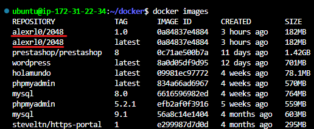
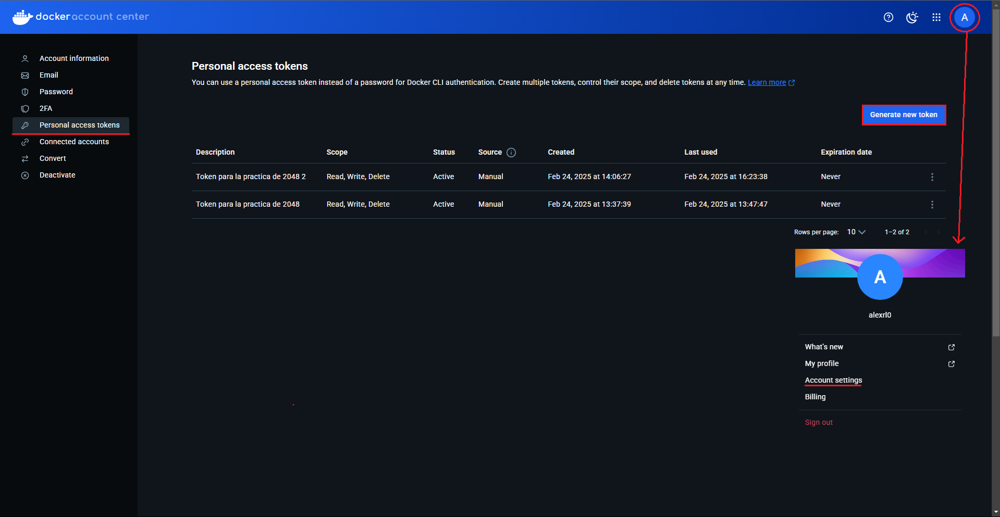
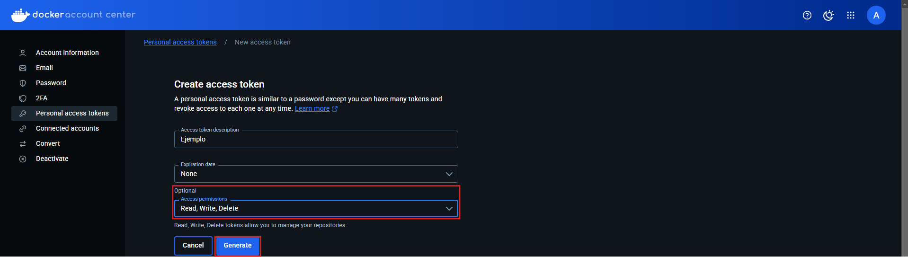

# Practica-IAW-5.4- «Dockerizar» una web estática y publicarla en Docker Hub.

## 1. Comando usado para montar la imagen del dockerfile y comprobar que la imagen esta montada correctamente

```bash
docker build -t alexrl0/2048 .
docker images
```

## 2. Comando usado para crear un tag a la imagen ya montada

```bash
docker tag alexrl0/2048 alexrl0/2048:1.0
```



## 3. Comando para iniciar sesión en dockerhub

```bash
docker login -u alexrl0
```

> [!IMPORTANT]  
> Al iniciar sesión con este comando, nos pedirá una contraseña, en vez de poner una contraseña, tenemos que crear un token en dockerhub con permisos de lectura, escritura y ejecución y pegarlo para poder iniciar sesión.

vamos por pasos, lo primero es inicar sesión en dockerhub con la cuenta de github, una vez iniciada la sesión, le damos click a nuestro perfil y se nos desplegará una ventana flotante como aparece en la imagen señalado con una flecha, cuando estemos en esa ventana, le damos a `Accounts settings` y nos aparecerá lo que sale en la imagen. Una vez dentro, le damos a `Personal access tokens` y dentro, le damos a `create new token`.



---

Cuando le damos a crear el nuevo token, nos aparecerá una ventana como la que se ve en la imagen, nos pedirá un nombre para el token, una fecha de caducidad que en mi caso no le he puesto y lo último pero lo más importante los permisos de la misma, tenemos que ponerle de lectura, escritura y ejecución porque si no, docker no va a poder subir la imagen a d



